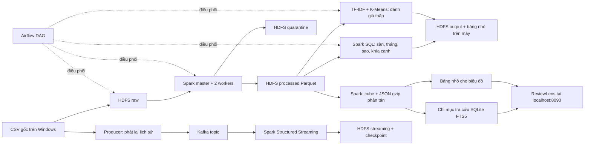

# Kiến trúc và logic Big Data

## Các khái niệm phải giải thích được

| Thành phần | Vai trò trong đồ án | Điều không được nhầm |
|---|---|---|
| NameNode | Namespace và metadata block HDFS | Không trực tiếp lưu mọi byte dữ liệu |
| DataNode | Chứa block, cung cấp dữ liệu cho client | Replication = 1 chỉ là demo tại máy |
| Spark driver | Lập logical/physical plan, điều phối stages và tasks | Không được `collect()` toàn bộ 1,3 triệu review |
| Spark executors | Tính toán trên partition | Master không phải executor xử lý nội dung |
| Transformation/action | Tạo kế hoạch / kích hoạt thực thi | `select` chưa nhất thiết đã đọc và xử lý toàn file |
| Shuffle | Trao đổi dữ liệu do groupBy/join/dedup | Chi phí mạng/đĩa, không chỉ chi phí CPU NLP |
| Parquet | Lưu cột, compression, schema, partition pruning | Không chỉ đổi đuôi CSV thành parquet |
| Kafka | Log sự kiện, topic, partition, offset | Không phải thay thế HDFS lưu toàn bộ lịch sử |
| Structured Streaming | Xử lý tăng dần bằng microbatch, checkpoint | Không chạy `while True` đọc lại hết CSV |
| Airflow | Lịch, dependencies, retries, logs | Không trực tiếp thay Spark xử lý dữ liệu lớn |
| Dashboard | Biểu đồ từ cube Spark, tra cứu qua chỉ mục xuất từ HDFS | Lớp phục vụ kết quả không thay HDFS/Spark xử lý nguồn |

## Hợp đồng dữ liệu

Raw: CSV nguyên bản. Schema 12 cột, cột đầu là index xuất CSV. `reviewid + appid` là khóa khử trùng, không dùng username.

Processed: khóa review được băm, platform, content, normalized_content, score, at, year, month, low_rating_proxy, spam_candidate, aspects_mentioned. Không mang theo username/userimage. Giữ phủ định “không”, “chưa”, “chẳng”.

Quarantine: dữ liệu sai schema, thiếu content, sao ngoài 1–5, thời gian không hợp lệ/ngoài [2013-01-01, 2022-09-01), app không được biết. Có reason, không âm thầm bỏ lỗi.

Dedup: chỉ xóa các bản sao cùng `appid + reviewid`, chọn có thứ tự theo timestamp và khóa nội dung. Nội dung giống nhau giữa các review khác nhau vẫn giữ để không thay đổi tỷ lệ sao không có căn cứ.

Partition processed theo platform/year; month là cột lọc. Đây là quyết định thực nghiệm cho tập 613 MB: chia theo platform/month ngay có thể tạo quá nhiều file nhỏ. Khi dữ liệu tăng, đo kích thước file và thời gian truy vấn trước khi đổi partition strategy.

## Mẫu số và tính đa nhãn

- `low_rating_rate = số review 1–2 sao / số review có sao hợp lệ` sau làm sạch và dedup, theo cùng sàn/giai đoạn.
- `aspect_mention_rate_among_low = số review 1–2 sao nhắc khía cạnh / số review 1–2 sao` cùng sàn/giai đoạn.
- Một review có nhiều khía cạnh: tổng số lần đề cập hoặc tổng tỷ lệ khía cạnh có thể vượt tổng review hoặc 100%.
- `unmatched` cần được công khai; không ép tất cả review vào một trong bảy khía cạnh.
- Flag spam là ứng viên kiểm tra, không nhãn spam chuẩn. Bản chính giữ review đã qua kiểm tra cấu trúc; có phân tích độ nhạy loại ứng viên spam.

## Kiểm chứng kỹ thuật

Đối soát số dòng; kiểm tra thứ tự dedup; `explain('formatted')`; số input/shuffle/output partitions; Spark UI stages/executors; HDFS blocks/Parquet; thời gian thực thi trên cấu hình cố định. So sánh một và hai worker chỉ là thí nghiệm trên cùng máy, có thể không tăng tốc vì overhead hoặc CPU/đĩa chung.

Kiểm chứng streaming gồm offset, inputRows, batchId, checkpoint và restart. Dedup toàn bộ review không dùng watermark cần state tăng theo dữ liệu; chỉ phù hợp demo replay hữu hạn, production cần retention/upsert design khác.

## Lớp phục vụ sản phẩm

Spark tạo cube sàn × tháng × sao × cờ spam, gồm số review/chưa gán/đề cập từng khía cạnh, rồi lưu HDFS và xuất bảng nhỏ. Dashboard cộng số đếm để tính tỷ lệ cho phạm vi mới, không lấy trung bình các tỷ lệ hoặc điểm trung bình theo nhóm. Tìm kiếm toàn bộ review dùng export JSON gzip từ Parquet HDFS → chỉ mục FTS5; build chỉ mục đọc tuần tự theo luồng, không gom toàn bộ văn bản vào RAM.

SQLite là lớp phục vụ trên laptop. Việc xử lý dữ liệu đầu vào, dedup, tổng hợp, Parquet, streaming vẫn dùng HDFS/Spark. Khi tăng số người tra cứu, có thể thay lớp phục vụ bằng hệ thống tìm kiếm phù hợp; không suy từ bản demo rằng SQLite là kho phân tán.

Metadata gắn generation cho cube/chỉ mục và đối chiếu số dòng; tệp chỉ mục được thay thế nguyên tử sau kiểm tra. Cache Docker chứa bản chỉ mục cùng generation để giảm I/O qua bind mount Windows, có thể xây lại từ exports. Các thay đổi dữ liệu cần hoàn tất job phục vụ trước khi dashboard công bố snapshot mới.

